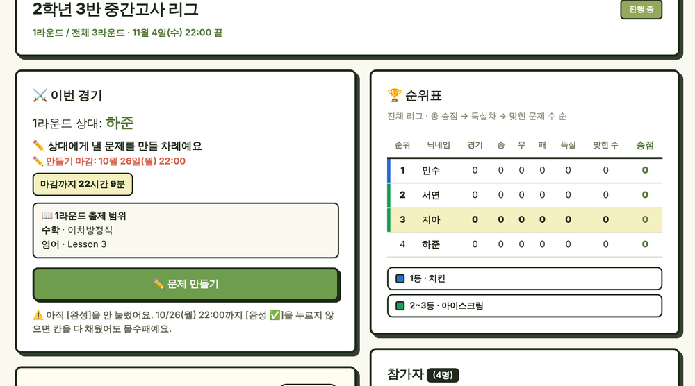
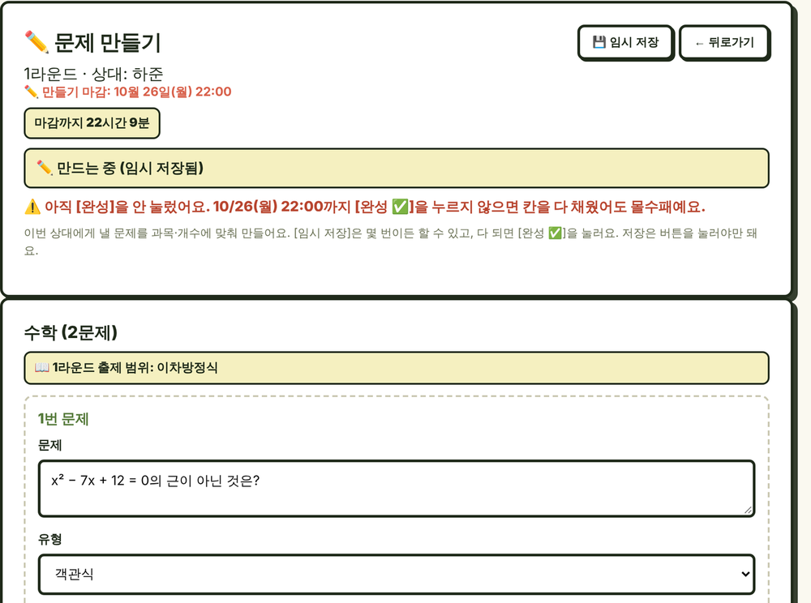
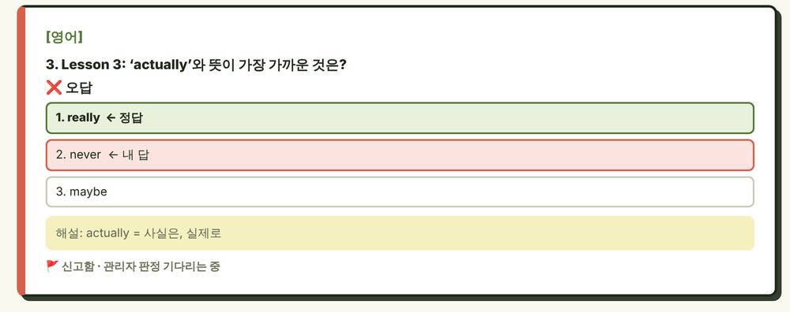
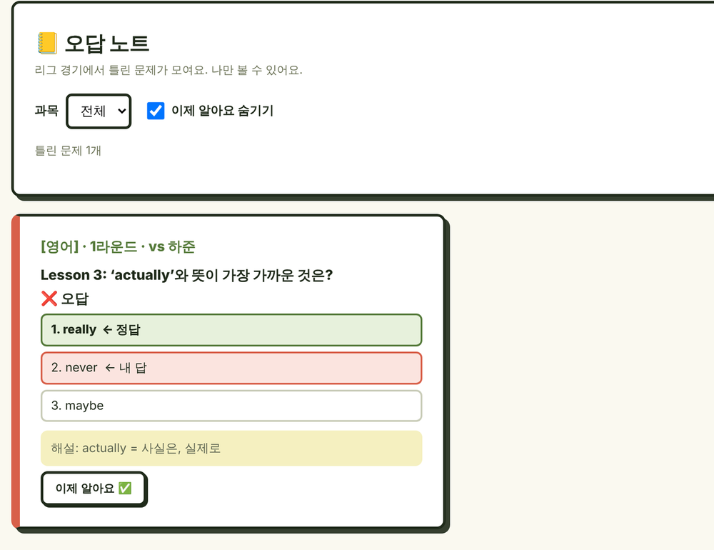
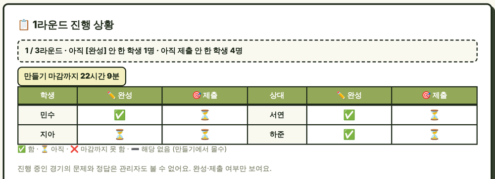
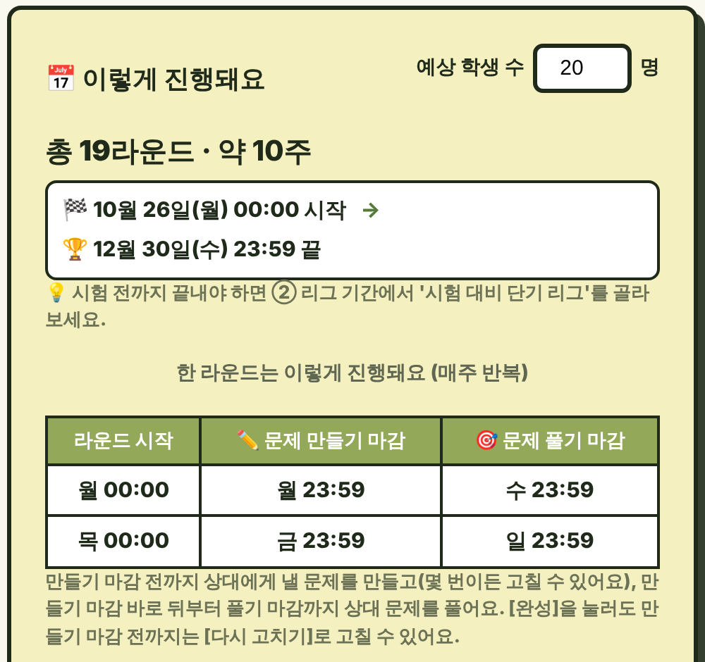
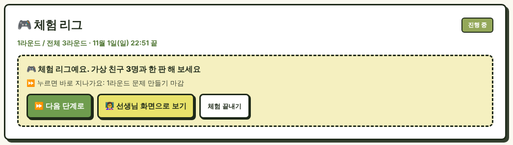

# 🏆 Class League (학교 공부 리그)

> 반 친구들과 서로 문제를 내고 풀며 승점을 쌓는 공부 리그 앱

- 실행 방법: [직접 실행하기](#직접-실행하기) (명령어 세 줄이면 내 컴퓨터에서 바로 써 볼 수 있어요)
- **바로 써 보기:** 첫 화면의 **[🎮 로그인 없이 혼자 체험해 보기]** → 가상 친구 3명과 한 판을 끝까지 (아래 [혼자 체험해 보기](#혼자-체험해-보기-1분))
- 기획(문제·해결, 다른 앱과 차이, 시나리오): [docs/PLAN.md](docs/PLAN.md)
- 자세한 기능·규칙: [docs/SPEC.md](docs/SPEC.md) · 기술 설명: [docs/ARCHITECTURE.md](docs/ARCHITECTURE.md)

## 어떤 앱인가요?
축구 리그처럼 학생 한 명이 팀 하나가 돼요. 라운드마다 상대가 바뀌고, 그 상대에게 낼 문제를 직접 만들어요. 상대 문제를 더 많이 맞히면 이겨요.

- **문제를 만들면서 복습**해요. 정답과 해설을 직접 쓰다 보면 개념이 정리돼요.
- **틀린 문제는 오답 노트에 저절로 모여요.** 시험 전에 과목별로 다시 볼 수 있어요.
- **대진표·마감·채점·순위는 앱이 자동으로** 해요. 선생님이나 반장이 일일이 챙기지 않아도 돼요.
- **시험 대비 단기 리그**를 고르면 시험 전날까지 끝나는 만큼만 경기해요.

## 해결하려는 문제
| 학교에서 겪는 문제 | Class League의 해결 |
|---|---|
| 혼자 하는 복습은 지루해서 오래 못 간다 | 경기마다 상대가 바뀌는 리그로 **‘이번 경기’라는 목표**를 만든다 |
| 문제를 풀기만 하면 이해가 얕다 | 상대에게 낼 **문제·정답·해설을 직접 만들며** 다시 정리한다 |
| 틀린 문제는 한 번 보고 잊어버린다 | 틀린 문제가 **오답 노트**에 저절로 모인다 |
| 반 전체 활동은 대진표·채점·순위 관리가 힘들다 | 대진·일정·채점·순위·**마감 처리를 앱이 자동**으로 한다 |
| 모두와 경기하면 시험 전에 끝내기 어렵다 | 시험 전날까지 끝나는 만큼만 하는 **시험 대비 단기 리그** |
| 이기려고 지엽적·장난 문제를 낼 수 있다 | **출제 범위** + 신고 → 관리자가 **무효** 판정 (푼 학생에게 1점) |

일반 퀴즈 앱은 정해진 문제를 **풀기만** 하지만, Class League는 학생이 **문제를 만들고 → 풀고 → 해설을 보며** 공부하고, 1:1 경기와 순위로 계속할 이유를 만들어요. 자세한 기획은 [docs/PLAN.md](docs/PLAN.md)에 있어요.

## 화면
| 리그 홈 (학생) | 문제 만들기 |
|---|---|
|  |  |
| **이번 경기** 카드에 상대·출제 범위·남은 시간·할 일이 한곳에 | 출제 범위를 보며 만들고, [완성] 안 하면 경고 |
| **채점 결과** | **오답 노트** |
|  |  |
| 제출 즉시 내 답·정답·해설, 이상한 문제는 [🚩 신고] | 틀린 문제가 과목별로 모이고 [이제 알아요]로 정리 |
| **선생님: 진행 상황** | **선생님: 리그 만들기 일정 미리 보기** |
|  |  |
| 누가 [완성]·제출했는지만 (진행 중 정답은 선생님도 못 봄) | 설정을 바꾸면 라운드 수·끝나는 날·마감이 바로 계산 |

## 혼자 체험해 보기 (1분)
계정도, 친구도, 리그 코드도 없이 **혼자서 한 판을 끝까지** 볼 수 있어요.

1. 첫 화면(또는 로그인 후 고르기 화면)의 **[🎮 로그인 없이 혼자 체험해 보기]**를 눌러요. 체험 계정이 바로 만들어지고, 가상 친구 3명(민수·지아·하준)과 **체험 리그**가 1라운드부터 시작돼요.
2. **이번 경기** → [✏️ 문제 만들기] → **[🪄 예시 문제로 채우기]** → [완성 ✅]
3. 리그 홈의 **[⏩ 다음 단계로]**를 누르면 마감이 바로 지나가요. 가상 친구는 알아서 문제를 풀어 제출해요.
4. [🎯 상대 문제 풀기] → 제출 → 채점 결과·오답 노트 확인. [⏩]를 계속 누르면 다음 라운드, 마지막엔 **최종 순위와 상품**이 나와요.
5. **[👩‍🏫 선생님 화면으로 보기]**로 같은 리그를 관리자 입장에서 봐요 (진행 상황·신고 판정·정답률). [체험 끝내기]를 누르면 체험 기록이 지워지고 진짜 리그에 들어갈 수 있어요.



체험 리그는 코드로 아무도 들어올 수 없고, 시각을 앞당기는 기능은 체험 리그에서만 동작해요 (진짜 리그는 서버가 막아요).

## 처음 써 보기 (5분, 진짜 리그)
학생 역할 계정 2개와 관리자 역할 계정 1개가 있으면 전체 흐름을 볼 수 있어요. 다른 브라우저나 시크릿 창을 쓰면 계정 여러 개로 동시에 로그인할 수 있어요.

1. **관리자**: 회원가입 → 관리자 카드의 [리그 만들기 →]
   - 과목, 문제 수, 출제 범위, 경기 요일, 마감 시각을 정해요.
   - 오른쪽 **📅 일정 미리 보기**에서 라운드 수와 마감 날짜가 바로 계산돼요.
2. **6자리 리그 코드**를 학생들에게 알려 줘요.
3. **학생**: 회원가입 → 학생 카드의 [코드 넣고 들어가기 →] → 코드 입력
4. **관리자**: 학생이 2명 이상 모이면 첫 경기 날짜를 고르고 [이 일정으로 시작]을 눌러요. 조건이 맞으면 오늘 바로 시작할 수도 있어요.
5. **학생**: 리그 홈의 **이번 경기** 카드에서 지금 할 일을 확인해요.

## 한 라운드는 이렇게 진행돼요
| 순서 | 학생이 하는 일 | 마감을 놓치면 |
|---|---|---|
| 1. 문제 만들기 | 상대에게 낼 문제·정답·해설을 쓰고 [임시 저장] → [완성] | 몰수패 |
| 2. 문제 풀기 | 만들기 마감 뒤 상대 문제를 풀고 한 번 [제출] | 몰수패 |
| 3. 결과 | 바로 채점되고, 둘 다 제출하면 승점이 순위에 반영돼요 | — |

- 승 3점 · 무 1점 · 패 0점이에요. 맞힌 개수가 많으면 이겨요.
- 만들기 마감 전까지는 [다시 고치기]로 문제를 고칠 수 있어요.
- 정답은 내가 제출하기 전까지 서버가 보내 주지 않아요.
- 다음 라운드는 시간이 되면 자동으로 시작돼요.

## 할 수 있는 것
**학생**
- 이번 경기: 상대, 출제 범위, 마감까지 남은 시간
- 순위표, 내 전체 일정, 지난 경기 (내 답·정답·해설 다시 보기)
- 오답 노트: 과목별로 보기, [이제 알아요]로 정리하기
- 범위 밖이거나 정답이 틀린 문제는 [🚩 신고]하기

**관리자** (선수로는 참가하지 않아요)
- 리그가 시작되면 메뉴 탭(진행 상황·신고·출제 범위·정답률)으로 필요한 것만 골라 봐요. 순위표는 늘 보이고, 순위표에서 학생 줄을 누르면 그 학생이 만든 문제와 [내보내기]가 나와요
- 리그 설정, 참가자 명단, 라운드별 출제 범위
- 이번 라운드 진행 상황, 과목별 정답률, 끝난 경기에 학생이 낸 문제
- 신고된 문제 판정: 무효로 판정하면 그 문제를 푼 학생에게 1점을 줘요.
- 전학 가는 학생 내보내기, 모집 중인 리그 삭제

**리그가 끝나면** 최종 순위와 상품이 나와요. [보관](학생)이나 [닫기](관리자)를 누르면 새 리그를 시작할 수 있고, 지난 리그 기록은 [📚 지난 리그]에서 다시 볼 수 있어요.

## 공정하고 안전하게
- 정답·해설은 권한과 경기 단계에 맞을 때만 서버가 보내요.
- 관리자도 진행 중인 경기의 정답, 학생이 입력한 답, 학생 개인 오답 노트는 볼 수 없어요.
- 비밀번호는 bcrypt로 암호화해서 저장해요. 로그인을 5번 틀리면 1분 동안 잠겨요.
- 받는 개인정보는 아이디와 닉네임뿐이에요.
- 로그인 쿠키는 다른 사이트에서 쓸 수 없고, 우리 사이트 파일만 실행되도록 보안 헤더를 붙여요 (`classleague/security.py`).

## 기술적으로 어려웠던 점
자세한 설명과 코드 위치는 [docs/ARCHITECTURE.md](docs/ARCHITECTURE.md)에 있어요.
- **스케줄러 없는 마감 자동 처리:** 요청이 올 때 밀린 마감을 한꺼번에 정산하고, DB 쓰기 잠금으로 여러 사람이 동시에 열어도 한 번만 처리해요.
- **정답 비공개:** 경기 단계와 사람에 따라 서버가 응답 자체를 다르게 만들어서, 개발자 도구로 봐도 제출 전에는 정답이 없어요.
- **대진·일정 계산:** 라운드 로빈 대진, 종료 희망일까지 끝낼 수 있는 단기 리그 라운드 수, 경기당 평균 순위를 직접 계산해요.
- **실시간 갱신:** 상대가 [완성]·제출하거나 마감이 지나면 열어 둔 리그 홈이 새로고침 없이 바뀌어요 (Server-Sent Events). 입력 중일 때는 덮어쓰지 않아요.
- **혼자 체험하기:** 가상 친구는 진짜 리그와 같은 채점·몰수·순위 코드를 그대로 지나가고, [다음 단계로]는 서버 시계 대신 체험 리그의 시각을 앞당겨 마감을 지나게 해요.
- **무효 재계산:** 신고된 문제를 무효로 하면 점수·승패·순위·정답률·오답 노트가 모두 다시 계산돼요.
- **시간 여행 테스트:** '지금 시각'을 한 곳에서만 정해서, 테스트가 시계를 돌려 마감·몰수·리그 종료를 기다리지 않고 확인해요.

## 직접 실행하기
Mac · Linux (터미널)
```bash
pip install -r requirements.txt
echo "SECRET_KEY=$(python3 -c 'import secrets; print(secrets.token_hex(32))')" > .env
flask --app app run --port 5000
```
Windows (PowerShell)
```powershell
pip install -r requirements.txt
python -c "import secrets; print('SECRET_KEY=' + secrets.token_hex(32))" | Out-File -Encoding ascii .env
flask --app app run --port 5000
```
브라우저에서 http://localhost:5000 을 열어요. 데이터베이스(`app.db`)는 처음 실행할 때 `app.py` 옆에 자동으로 만들어져요.

- `.env`(로그인 상태를 지키는 비밀키)는 없어도 실행돼요. 그때는 임시 비밀키를 쓰고, 서버를 다시 켜면 로그인이 풀려요.
- Windows에서 `> .env`로 만들면 파일이 UTF-16으로 저장돼 `flask`가 `UnicodeDecodeError`를 내며 켜지지 않아요. 위 명령처럼 `Out-File -Encoding ascii`로 만들거나, `.env`를 지우고 다시 실행해요.

### 테스트
```bash
pip install -r requirements-dev.txt
pytest
```
진짜 `app.db`는 건드리지 않고 시험마다 빈 DB를 새로 만들어요. 시계를 앞으로 돌려 마감·몰수·리그 종료까지 확인해요.

## 만든 기술과 파일
- 서버: Python 3.12, Flask, SQLite, Flask-Login, Flask-Bcrypt
- 화면: HTML·CSS·JavaScript (프레임워크 없음), PWA (설치·오프라인 안내)
- 시간: 화면은 한국 시간으로 보여 주고, DB에는 UTC로 저장해요.

| 파일 | 하는 일 |
|---|---|
| `app.py` | 서버 진입점: 앱 설정, 로그인·API 연결, 오류 안내 |
| `classleague/db.py` · `clock.py` · `inputs.py` | DB 연결과 표, 시각(KST/UTC), 요청 입력 읽기 |
| `classleague/schedule.py` · `standings.py` | 대진표·일정 계산, 순위 계산 (DB 없이 계산만) |
| `classleague/engine.py` · `league_state.py` | 마감 자동 처리(몰수)·채점·결과 재계산, 리그 상태 조회 |
| `classleague/routes/` | API: 로그인(`auth`), 리그(`leagues`), 경기(`matches`), 관리자(`admin`), 신고(`reports`), 오답 노트(`notes`), 실시간 갱신(`live`), 혼자 체험하기(`demo`) |
| `templates/index.html` | 화면 뼈대. 화면마다 `templates/partials/`(처음 화면, 로그인, 리그 홈, 문제 만들기, 오답 노트 …)를 붙인다 |
| `static/css/01-base.css` ~ `11-extras.css` | 화면 모양. 번호 순서대로 불러온다 (기본 → 리그 → 문제 → … → 화면 배치) |
| `static/js/01-core.js` ~ `11-notes.js` | 화면 동작. 번호 순서대로 불러온다 (공통 도구 → 로그인 → 리그 홈 → … → 오답 노트) |
| `static/sw.js` · `static/manifest.webmanifest` | 홈 화면 설치, 오프라인 안내 |
| `docs/SPEC.md` | 기능 정의서, 화면, 규칙과 예외 상황, 완료 기준 |
| `tests/` | 자동 테스트: 대진·일정 계산, 경기 흐름, 권한·이상한 입력, 신고·리그 생명주기 |
